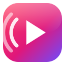
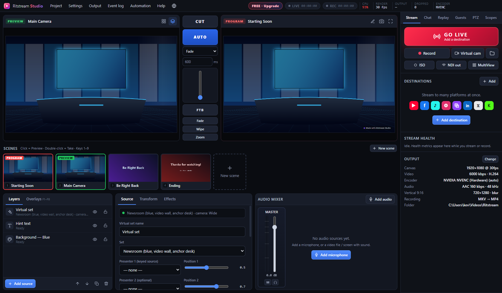

<h1 align="center">Ritstream Studio</h1>

<b>Live production and multistreaming for Windows and macOS.</b> 
Switch cameras, add broadcast graphics, bring in remote guests, and go live on YouTube, Facebook, TikTok, Instagram, Twitch and more, all at once.

  <a href="https://sirrjay.github.io/ritstream/"><b>Website</b></a> ·
  <a href="https://github.com/SirrJay/ritstream/releases/latest"><b>Download</b></a>

## Download

| Platform | File |
|---|---|
| Windows 10/11 (64-bit) installer | [Ritstream-Studio-Setup-x64.exe](https://github.com/SirrJay/ritstream/releases/latest/download/Ritstream-Studio-Setup-x64.exe) |
| Windows portable (no install) | [Ritstream-Studio-Portable-x64.exe](https://github.com/SirrJay/ritstream/releases/latest/download/Ritstream-Studio-Portable-x64.exe) |
| macOS, Apple Silicon (M1 and later) | [Ritstream-Studio-mac-arm64.dmg](https://github.com/SirrJay/ritstream/releases/latest/download/Ritstream-Studio-mac-arm64.dmg) |
| macOS, Intel | [Ritstream-Studio-mac-x64.dmg](https://github.com/SirrJay/ritstream/releases/latest/download/Ritstream-Studio-mac-x64.dmg) |

**First launch.** On Windows, if "Windows protected your PC" appears, click **More info → Run anyway**. On a Mac, if macOS says the app can't be opened, go to **System Settings → Privacy & Security** and click **Open Anyway** (once).

## Highlights

- **Vision mixer:** Preview/Program, CUT, AUTO and T-Bar, 18 transitions including stingers and luma wipes, 8 overlay channels, MultiView.
- **Multistreaming:** encode once and stream to every platform at the same time, plus an automatic vertical 9:16 stream for TikTok, Reels and Shorts.
- **Inputs:** cameras, capture cards (HDMI/SDI), screens, NDI®, IP cameras (RTSP / SRT / RTMP / HLS / UDP), video playlists, PowerPoint/Keynote and web pages.
- **Remote guests:** up to 8 guests join from a browser link, with a return feed and mix-minus.
- **Graphics:** Title Designer with animated templates, lower thirds, tickers, scoreboards, and live data from Excel, CSV, JSON, XML or Google Sheets.
- **Virtual sets**, colour grading, video scopes, and a telestrator.
- **Audio:** per-channel EQ, gate, compressor and delay; aux buses; audio-follow-video.
- **Recording:** MP4, MKV, MOV, AVI, MPEG-2 and audio-only; MultiCorder ISO recording of every camera; instant replay from up to 8 angles.
- **Control:** Web Controller for phones and tablets, HTTP/TCP API (Stream Deck via Companion), MIDI, custom shortcuts, macros, and PTZ camera control.
- **8 languages:** English, Français, Español, Português, Deutsch, العربية, 中文, हिन्दी.

## Editions

Ritstream Studio is free to download. The free version streams to one destination at 720p with a small watermark. **Pro** and **Studio** plans (monthly, quarterly, yearly or lifetime) unlock everything. Buy them inside the app under Help → License & upgrade; the app activates itself automatically.

---

© 2026 Ritstream. NDI® is a registered trademark of Vizrt NDI AB. Platform names are trademarks of their respective owners.
